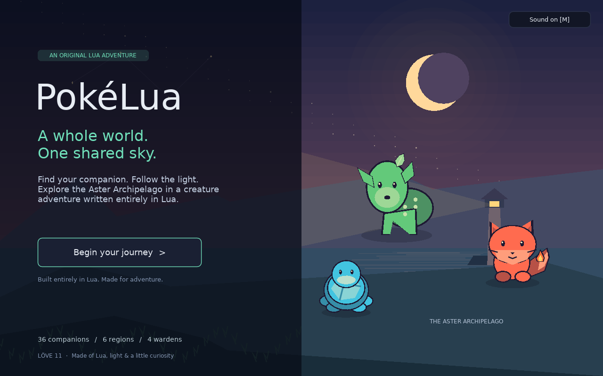
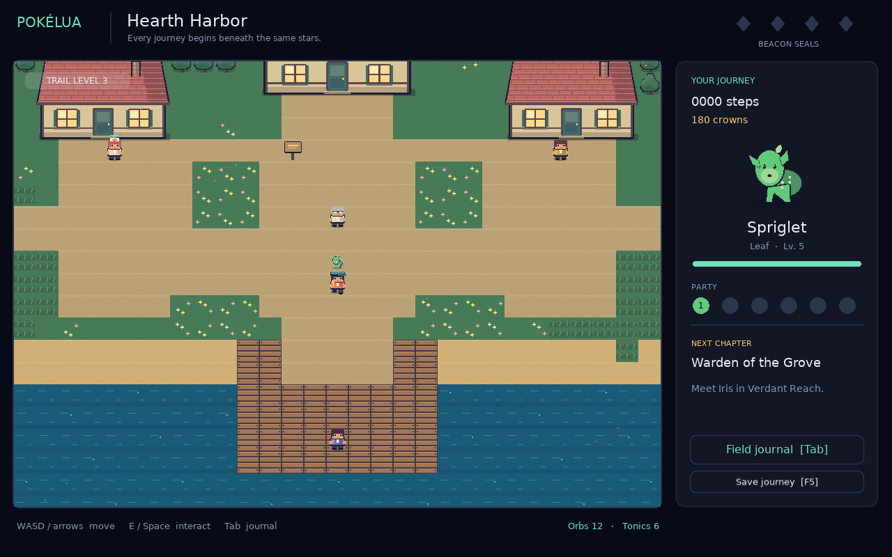
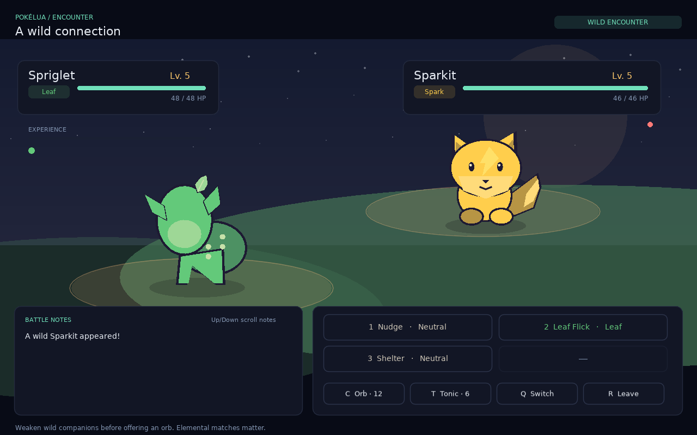

# PokéLua

**A creature adventure beneath one shared sky.**

PokéLua is an original, single-player monster-catching RPG written in Lua for [LÖVE](https://love2d.org/). Explore the Aster Archipelago, choose a companion, earn four wardens’ trust, and restore a celestial beacon. The campaign has an ending and an open postgame.



## Play

Install **LÖVE 11.4 or later**, then download [`dist/PokeLua.love`](dist/PokeLua.love) and open it with LÖVE. On Windows, drag the file onto `love.exe`; on macOS, open it with the LÖVE app; on Linux, run `love PokeLua.love`.

To run from source:

```sh
git clone https://github.com/mrcloudchase/pokelua.git
cd pokelua
love .
```

No asset downloads, accounts, services, or network connection are needed to play. Windows, macOS, and Linux are supported through LÖVE; the executable package was tested on Linux with LÖVE 11.5.

## The adventure

- **36 original companions** across ten elements, including three starter evolution lines and a postgame legendary.
- **Six explorable regions**, from Hearth Harbor to the Astral Observatory, with connected trails, encounters, characters, signs, and landmarks.
- **Four wardens and nine optional travelers** with elemental teams, rewards, progression gates, and a final story sequence.
- **Turn-based battles** with techniques, elemental advantages, guarding, healing, switching, and escape.
- **Catching, shared experience, evolution**, a six-member party, and sanctuary storage with exchanges and release.
- **A field journal** with creature discoveries, stats, techniques, supplies, regional fast travel, and progress.
- **Shops, free healing, and rescue** after defeat. A lost battle never ends the journey.
- **Local saves with backup recovery**, procedural artwork, animated creatures, original synthesized music, sound effects, mute, fullscreen, and a resizable window.

All game logic, maps, dialogue, artwork generation, and sound synthesis are Lua. There are no external game assets or third-party game libraries beyond LÖVE itself.





## Controls

| Action | Keys |
| --- | --- |
| Move | Arrow keys / WASD |
| Talk, read, advance dialogue | E / Space / Enter |
| Open field journal | Tab / Escape |
| Journal sections / selection | Left–Right / Up–Down |
| Confirm / return | Enter / Escape |
| Battle technique | 1–4; Enter uses the first technique |
| Offer a binding orb / tonic | C / T |
| Switch companion / flee | Q, then 1–6 / R |
| Scroll battle notes | Up–Down / mouse wheel |
| Open sanctuary from Party | X |
| Release a stored companion | Delete twice, or click Release twice |
| Buy an orb / tonic in a shop | 1 / 2 |
| Save / mute / fullscreen | F5 / M / F11 |

Buttons and journal entries also work with the mouse. Tab or Escape returns to the trail from the journal. Use the Bag section to restore HP outside battle.

## Your first steps

Choose Spriglet, Cindercub, or Dripple. Read Professor Selene’s introduction, then follow the eastern path toward Verdant Reach. Walk through tall grass to meet wild companions. Weaken them before offering an orb. Matching a technique to your companion’s own element adds a bonus; a strong elemental matchup doubles damage. The Bag section includes an element guide.

Build a varied party and visit caretakers for free healing. Every living party member shares battle experience. New techniques and evolutions happen automatically as companions level up. Completed regions unlock free travel in the journal’s Map section.

Earn the Grove, Cinder, Tide, and Astral Sigils to restore the Beacon. After the ending, keep exploring and seek Aetherion in the Observatory grass.

## Saving

The game autosaves after starter selection, travel, completed encounters, healing, purchases, and warden victories. F5 saves on the trail. Starting a new journey replaces the existing save when you choose a starter.

Battles use a checkpoint: closing the game during an unfinished encounter restores the state before that encounter. Press **Continue** at the end of battle to commit captures, rewards, and experience. F5 is unavailable during battle.

Saves live in LÖVE’s `pokelua` application directory as `journey.pokelua`, alongside a recovery backup. The format has a checksum and is parsed as data, never executed as Lua. Typical locations:

- Windows: `%APPDATA%\LOVE\pokelua`
- macOS: `~/Library/Application Support/LOVE/pokelua`
- Linux: `~/.local/share/love/pokelua`

## Development

```sh
lua tests/run.lua      # Lua 5.1+, or use luajit
lua scripts/package.lua
love . --smoke        # actual scene/capture/save integration + screenshots
```

Packaging requires the `zip` command and creates `dist/PokeLua.love`. The archive includes the game source and license; tests and screenshots are excluded from the playable archive.

For a headless Linux smoke run:

```sh
ALSOFT_DRIVERS=null LIBGL_ALWAYS_SOFTWARE=1 xvfb-run -a love . --smoke
```

The smoke run uses a separate `pokelua-smoke` save identity and writes screenshots to `dist/screenshots/`. Automated checks cover combat, evolution, capture, invalid actions, save corruption and recovery, map reachability, progression gates, gameplay transitions, and 18 seeded campaign simulations across every starter and two play styles. CI runs the unit suite, real-engine smoke test, and packaging, and uploads a playable artifact.

See [ARCHITECTURE.md](ARCHITECTURE.md) for the module layout and [CHANGELOG.md](CHANGELOG.md) for this release.

PokéLua’s creatures, world, art, music, and story are original. This is an independent game inspired by the creature-collecting RPG genre.
